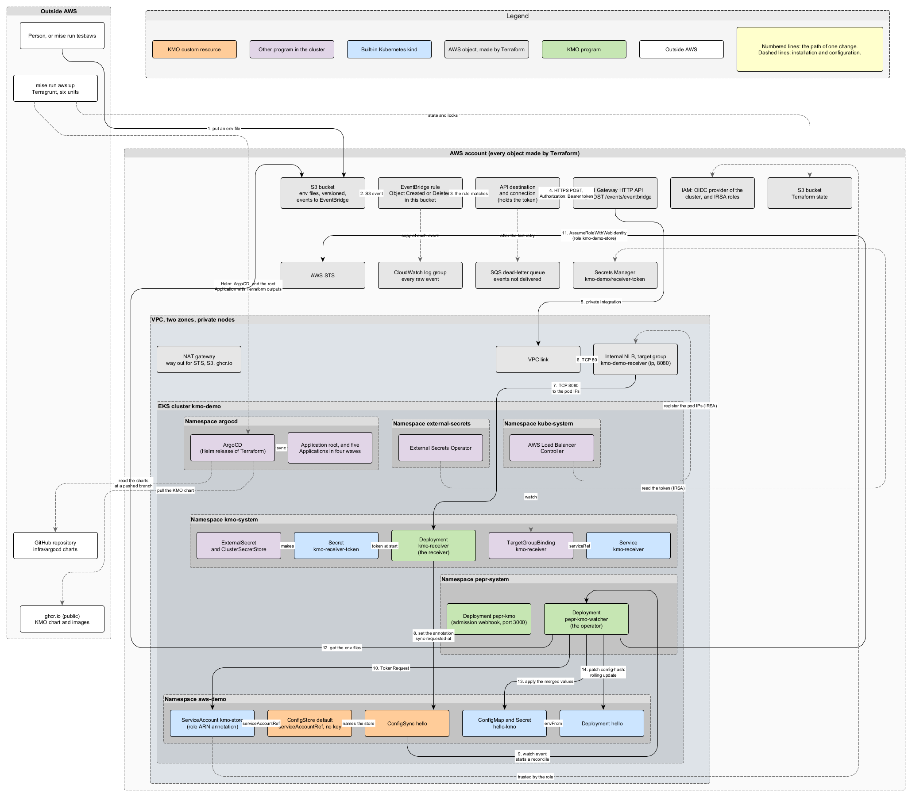

# The demo on AWS

The demo puts KMO in a real EKS cluster and shows the whole path of a change, from an S3 bucket to a rolled pod. It
costs about $0.30 an hour while it runs. `mise run aws:down` ends it. The bucket that holds the Terraform state stays
until you delete it: see [Deleting the state bucket](#deleting-the-state-bucket).

## What it shows

One changed file travels this path:

1. A person writes an env file in the config bucket. S3 sends an event to EventBridge.
2. An EventBridge rule matches the event. A connection adds the receiver's token as `Authorization: Bearer`, and an API
   destination sends the event to an HTTP API in API Gateway. API Gateway holds the public HTTPS address.
3. A VPC link takes the request into the VPC, to a Network Load Balancer (NLB).
4. A `TargetGroupBinding` in the cluster puts the receiver's pod IPs into the target group of the NLB.
5. The receiver turns the event into the sync annotation on the matching ConfigSync.
6. The operator reads the bucket as the ServiceAccount `kmo-store`, with no stored key. It writes the ConfigMap and the
   Secret, and changes the hash on the Deployment `hello`.
7. Kubernetes replaces the pods of `hello`, and they start with the new value.

An event that EventBridge cannot deliver goes to a dead-letter queue.

## What it needs

- An AWS account, and an AWS CLI profile with the right to make the objects in the table below.
- The variable `AWS_REGION`, set on each command. An `export` in one shell does not carry over to the next command.
- Mise. It pins Terraform, Terragrunt, kubectl and the other tools.

It needs no GitHub credential. The repository and the packages on GitHub are public. With a fork, ArgoCD looks for the
chart at `ghcr.io/<fork owner>/charts`. That exists only if the fork publishes public packages. If it does not, set the
owner of `kmo-charts` back to the upstream owner.

## How to run it

- `mise run aws:up` makes everything with Terragrunt, then writes a kubeconfig for the cluster to `.kube/eks`. ArgoCD
  then installs the rest in the cluster.
- `mise run test:aws` checks the demo. It writes files in the config bucket and changes nothing else in AWS, so it can
  run many times on one cluster. It is described below.
- `mise run aws:down` deletes everything that `aws:up` made, except the state bucket. If an `aws:up` failed, run
  `aws:down`. It removes what `aws:up` made. Each cycle leaves the KMS key of the EKS cluster waiting 30 days for
  deletion. Such keys cost nothing.

ArgoCD reads only code that is pushed. To run the demo from a branch other than `main`, push the branch and set
`KMO_DEMO_REVISION` to its name on the command of `aws:up`.

Each of the three tasks creates, changes or deletes AWS resources. [Commands](commands.md#the-proof-on-aws) lists them.

## Where each part is

| Place                   | What it holds                                                                                                                |
| ----------------------- | ---------------------------------------------------------------------------------------------------------------------------- |
| `infra/live/demo/`      | One Terragrunt unit for each part: `network`, `eks`, `store`, `ingress`, `events` and `platform`. It holds inputs and order. |
| `infra/modules/`        | The Terraform of each unit.                                                                                                  |
| `infra/argocd/root/`    | The chart of the root Application. It makes the other five Applications.                                                     |
| `infra/argocd/secrets/` | The ClusterSecretStore and the ExternalSecret that make the receiver's token.                                                |
| `infra/argocd/demo/`    | The namespace `aws-demo`, the store, the ConfigSync, the workload and the `TargetGroupBinding`.                              |

The units hold these AWS objects:

- `network` is a VPC with private subnets.
- `eks` is the cluster, a node group, an OIDC provider in IAM, and the roles of the Load Balancer Controller and of
  External Secrets Operator.
- `store` is the config bucket, with two env files in it, and the role of the store.
- `ingress` is the NLB, the HTTP API, the VPC link and the security groups between them.
- `events` is the rule, the connection, the API destination, the dead-letter queue, a log group, and the receiver's
  token in AWS Secrets Manager.
- `platform` installs ArgoCD in the cluster.

Every AWS object is made by Terraform. Nothing in the cluster makes a load balancer or a security group rule. For this
reason, the Load Balancer Controller does only one thing: its role may bind target groups whose name starts with
`kmo-demo-`, and it has no right to make a load balancer. Its settings `enableServiceMutatorWebhook` and
`enableBackendSecurityGroup` are off.

The node group has one rule that the module does not have by default: the control plane may reach port 3000 on the
nodes. That is the port of KMO's admission webhook. Without the rule, the API server cannot call the webhook.

## How ArgoCD installs it

Terraform installs ArgoCD with Helm, and then a second Helm release makes the root Application. The Application kind
does not exist until the release of ArgoCD is in, so the two cannot be one release. The root Application makes five
more, in four sync waves. ArgoCD finishes one wave, and waits until all its Applications are Healthy, before it starts
the next.

1. `aws-load-balancer-controller` and `external-secrets`.
2. `kmo-secrets`: the ClusterSecretStore, and the ExternalSecret that makes the Secret `kmo-receiver-token` in
   `kmo-system`.
3. `kmo`: the published chart. The version is in `infra/argocd/root/values.yaml`.
4. `demo`.

The token has a wave of its own, before KMO, for this reason: ArgoCD waits for KMO to be Healthy, and the receiver
cannot be Healthy without its token. If the token was in the last wave, the installation would wait for ever.

Two settings of ArgoCD make this work. A health check for Applications lets the root wait for each wave. A sync timeout
of 300 seconds ends a sync that waits for values that are not there yet, and the root Application retries it with the
new values.

## What `test:aws` checks

The test waits until every Application is Synced and Healthy. Then it checks that the store names a ServiceAccount and
no Secret, that the store is Ready, and that `hello` runs with the value in the bucket. It checks that the admission
webhook refuses a second ConfigSync on the same target.

Then it writes a new value and checks, within 60 seconds, that `hello` rolled to it and that the receiver logged the
event. Such a time can only be met by an event, because the refresh interval of the ConfigSync is 30 minutes. It checks
that a hard refresh of the demo in ArgoCD leaves the demo Synced and does not change the hash. It replaces the
receiver's pod, waits for the NLB to send to the new pod, and does a second change.

At the end it writes a file whose key holds a space and a plus sign, and checks that EventBridge and the receiver both
show the key as it was written. It checks that no event of the run went to the dead-letter queue.

Only an event makes the pod follow a change at once. A write that no event carries, for example when the rule is
disabled, reaches the pod at the next refresh of the ConfigSync (30 minutes by default) or with the next write. Until
then the bucket is ahead of the pod.

## How to look at it

- `kubectl get applications -n argocd` shows each Application. Use the kubeconfig that `aws:up` wrote, for example with
  `KUBECONFIG=.kube/eks`.
- `kubectl logs -n kmo-system deployment/kmo-receiver` shows one line for each event the receiver handled.
- The dead-letter queue is `kmo-demo-dead-letters`. A message in it is an event that EventBridge could not deliver.
- The log group `/aws/events/kmo-demo` holds every event that the rule matched, as EventBridge sent it.

## Deleting the state bucket

`aws:down` keeps the bucket `kmo-demo-tfstate-<account>-<region>`, because it holds the state of a demo that may still
exist. After the last `aws:down`, delete it by hand. The bucket is versioned, so empty it of all versions and delete
markers first, and then delete it.

## Read next

- [Stores in AWS without stored keys](aws-identity.md) explains the identity of the store.
- [The receiver](receiver.md) describes the token and the paths of events.
- [Known limits](limits.md) lists what the demo does not do.
